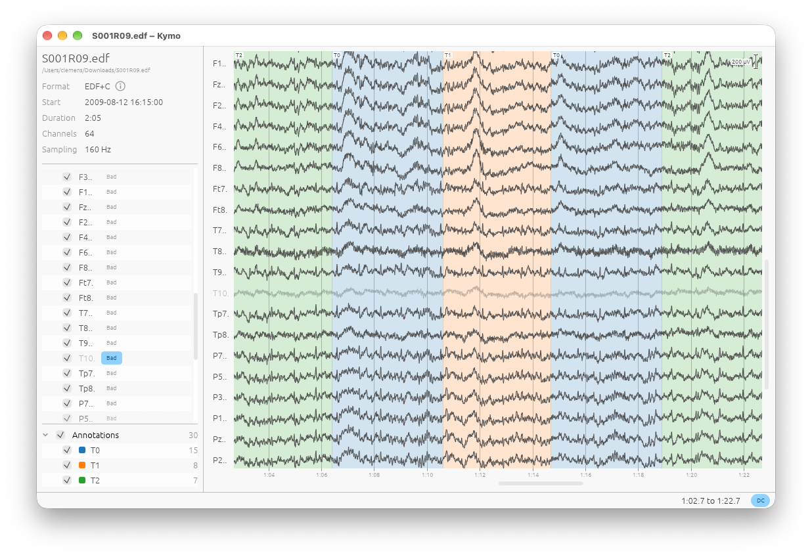

# Kymo

Kymo is a fast viewer for EEG and MEG recordings. It opens even huge recordings almost instantly and lets you scroll and zoom smoothly with little memory, no matter how large the file.



Kymo is named after the kymograph, a rotating drum used to record physiological signals in the 19th century.

> Kymo is under active development and has not been released yet. It already runs as a standalone viewer on macOS, Windows, and Linux. Integration with [MNE-Python](https://mne.tools) and [MNELAB](https://github.com/cbrnr/mnelab) is planned (see the [roadmap](#roadmap)).

## Why Kymo?

- **Recordings open almost instantly.** The first view appears in under a second while Kymo builds an overview of the entire recording in the background. It caches this overview, so subsequent openings are even faster.
- **Scrolling and zooming stay smooth.** Kymo targets 60 frames per second or more, whether you are viewing a few samples or the entire recording. If some data is not ready yet, it shows a coarser version until the detail is available.
- **Memory use stays low.** Kymo never loads the entire recording into memory. It reads only the data needed for the current view, so even a 45 GB file needs only a few hundred megabytes.
- **Every peak remains visible.** When you zoom out, each pixel shows the minimum and maximum of all samples it covers, so spikes and artifacts never disappear.
- **Rendering uses the GPU.** Kymo draws with Metal, Vulkan, or DirectX 12.

### Benchmarks

The following table compares Kymo with [MNE-Qt-Browser](https://github.com/mne-tools/mne-qt-browser), the default browser in MNE-Python. All measurements were taken on the same MacBook Pro with an M2 Pro chip and 32 GB of RAM.

| Recording | Viewer | Frame time while scrolling (p99) | Zoom out to the whole recording | Peak memory |
| --- | --- | --- | --- | --- |
| 64 channels, 1 h, EDF | **Kymo** | **10 ms** | **8 ms per step** | **125 MB** |
| | MNE-Qt-Browser | 16 ms to 2.5 s | 2.8 s per step | 7.7 GB |
| 306 channels, 1 h, EDF | **Kymo** | **9 ms** | **8 ms per step** | **158 MB** |
| | MNE-Qt-Browser | 22 ms to 4.3 s | 4.6 s per step | 13.9 GB |
| 256 channels, 8 h, BDF (45 GB) | **Kymo** | **11 ms** | **31 ms per step** | **280 MB** |
| | MNE-Qt-Browser | did not finish | stopped after 10 min | 67.6 GB |

The Kymo measurements are for files that have been opened before. The first time you open a file, scrolling is just as fast, but the zoomed-out view fills in as Kymo builds the overview.

## Features

Keys are given for macOS. On Windows and Linux, <kbd>Ctrl</kbd> replaces <kbd>⌘</kbd>, <kbd>Alt</kbd> replaces <kbd>⌥</kbd>, and <kbd>Shift</kbd> replaces <kbd>⇧</kbd>.

### Supported file formats

| Format | Files |
| --- | --- |
| EDF, EDF+ and BDF, BDF+ (continuous and discontinuous) | `.edf`, `.bdf` |
| BrainVision | `.vhdr` with `.eeg` and `.vmrk` |
| BVRF (BrainVision Recording Format) | `.bvrh` with `.bvrd` and `.bvrm` |
| EEGLAB | `.set`, with or without `.fdt` |
| FIFF (MNE-Python, Neuromag/MEGIN) | `.fif` |
| GDF 1.x and 2.x | `.gdf` |
| XDF | `.xdf` |

- Kymo identifies the format from the file contents instead of the extension. Opening any file of a recording set (for example, a BrainVision `.eeg` file) opens the entire recording.
- Channels can have different sampling rates. Gaps in a recording are shown as empty space.
- XDF streams are synchronized and dejittered as in [PyXDF](https://github.com/xdf-modules/pyxdf). Marker streams are shown as annotations.
- BVRF recordings with multiple participants group each participant's channels and markers separately.
- Kymo's readers are checked against MNE-Python, PyXDF, and [PyBVRF](https://github.com/cbrnr/pybvrf).
- Kymo never modifies your recording files.

### Navigation

- Scroll and zoom with your trackpad, mouse wheel, or keyboard. Jump to the beginning or end, go to a specific time, or fit the entire recording on the screen.
- Move through the channels and choose how many to display at once.
- Hover over a trace to see its value at that point.
- Open recordings from the command line, the **File** menu, the recent files list, or by dragging them onto the window.
- **File → Recording Info** shows the recording's header fields, start time, duration, sampling rates, streams, and channel groups.

### Channels and scaling

- The sidebar lists channels grouped by type (and by stream or participant for XDF and BVRF). You can collapse groups and show or hide individual channels or entire groups.
- Select channels as in any list (click, <kbd>⌘</kbd>-click, or <kbd>⇧</kbd>-click) and mark them as bad. Channels the recording already marks as bad are recognized.
- Channel types are names, not a fixed list. Kymo recognizes common types (including those of MNE-Python, BIDS, and EDF+) and keeps any other type names found in the recording.
- Change the type of one or more channels from the menu at the end of a channel row: choose an existing type, enter a new name, or select **From File** to restore the type stored in the recording.
- Each channel type has its own color, DC removal, and scale, set in the sidebar or in the **Channel Types** window. Kymo remembers these settings by type name across recordings.
- Save channel types and bad channels to a [BIDS](https://bids.neuroimaging.io) `channels.tsv` file, or load them from one.
- Channels of the same type and unit share an amplitude scale. Use **Auto Scale** to fit the scales to the current view, or set them manually. Scale bars and values use a suitable unit (for example, 2 mV instead of 2000 µV).
- Scale a single channel by <kbd>⌥⇧⌘</kbd>-scrolling or -pinching over its trace, or the selected channels with <kbd>⌥⇧⌘+</kbd> and <kbd>⌥⇧⌘−</kbd>. A ↕ next to the channel name marks it; click it to return to the type's scale.
- DC removal keeps channels with large offsets centered in their rows. It is applied only to types whose absolute level is not meaningful, so temperature or oxygen saturation, for example, keep their levels.

### Measuring

- Hold <kbd>⇧</kbd> and drag across the traces to measure between two points. The label shows the time difference, the corresponding frequency, and the peak-to-peak amplitude of the channel in between, accurate at any zoom level.
- The status line shows both endpoints' times and values and the number of samples between them.

### Annotations and events

- Annotations from a recording appear as colored bands and lines. Use the legend to show, hide, or recolor them by description.
- Kymo detects events in trigger (stim) channels.
- In annotation editing mode, drag to create an annotation, then move, resize, rename, merge, or delete it, with undo and redo.
- Save annotations as a BIDS events file (`.tsv`), or load them from one or from an MNE-Python annotations CSV file.

### Look and feel

- Choose a light or dark theme, or follow your system setting.
- Choose your own colors for channel types and annotations.
- Kymo uses native menus and standard keyboard shortcuts on each platform; **Help → Keyboard Shortcuts** lists them all.
- Your settings are saved between sessions.

## Installation

Until the first release, you need to build Kymo from source. This requires [Rust](https://rustup.rs) 1.95 or later and a C compiler. See [CONTRIBUTING.md](CONTRIBUTING.md) for platform-specific setup instructions.

```sh
git clone https://github.com/cbrnr/kymo.git
cd kymo
cargo build --release -p kymo
```

The executable is available at `target/release/kymo` (`kymo.exe` on Windows).

Kymo requires a graphics driver that supports Metal (macOS), DirectX 12 or Vulkan (Windows), or Vulkan (Linux).

## Usage

```sh
kymo recording.bdf          # open a recording
kymo                        # choose a file in a dialog
kymo --info recording.fif   # print a recording summary without opening a window
```

## Roadmap

- **Display filters:** High-pass and low-pass filters, similar to those in MNE-Python's `raw.plot()`.
- **Python package:** Install with `pip install kymo` and use `kymo.plot(raw)` to view any MNE-Python `Raw` object, with bad channels and annotations passed back to Python.
- **MNE-Python backend:** Open Kymo directly from `raw.plot()`.
- **MNELAB:** Use Kymo as the signal viewer in MNELAB.
- **More:** Additional file formats, re-referencing, and names for event codes.

## Contributing

Contributions are welcome! [CONTRIBUTING.md](CONTRIBUTING.md) explains how to set up your development environment, build Kymo, and run the checks. The [design document](docs/design.md) describes the architecture.

## License

Kymo is licensed under the [BSD 3-Clause License](LICENSE).
